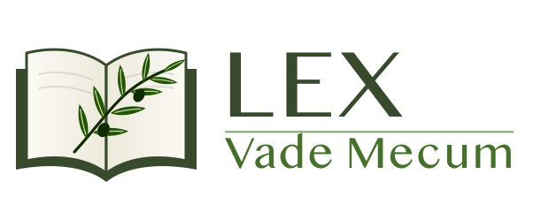

  

<strong>Leis brasileiras em Markdown, fiéis ao texto oficial e prontas para IA.</strong>

# Lex Vade Mecum

Biblioteca de leis brasileiras em Markdown, extraídas do texto oficial publicado no Portal da Legislação do Planalto e estruturadas para consulta por modelos de linguagem (Claude, GPT, Cursor, Windsurf, Copilot e similares), buscas semânticas e recuperação de contexto (RAG). O repositório é pensado para servir de fonte principal em projetos do Claude.

## Acesso direto às leis

Clique em "Ler on-line" para abrir a norma inteira (texto oficial com a análise de cada artigo) diretamente no GitHub.

<!-- catalogo:inicio -->
| Norma | Número | Data de publicação | Leitura on-line (arquivo inteiro) | Texto oficial | Conferido com o Planalto em |
| --- | --- | --- | --- | --- | --- |
| Constituição da República Federativa do Brasil de 1988 | — (compilada até a EC nº 141/2026) | 5 de outubro de 1988 (DOU nº 191-A) | [Ler on-line](leis/constituicao-federal/constituicao-federal-completa.md) | [Planalto](https://www.planalto.gov.br/ccivil_03/constituicao/constituicaocompilado.htm) | 06/11/2026 |
| Código de Processo Civil (CPC) | Lei nº 13.105 | 16 de março de 2015 (DOU de 17.3.2015) | [Ler on-line](leis/cpc/cpc-completa.md) | [Planalto](https://www.planalto.gov.br/ccivil_03/_ato2015-2018/2015/lei/l13105.htm) | 06/11/2026 |
| Lei de Introdução às Normas do Direito Brasileiro (LINDB) | Decreto-Lei nº 4.657 | 4 de setembro de 1942 (DOU de 9.9.1942) | [Ler on-line](leis/lindb/lindb-completa.md) | [Planalto](https://www.planalto.gov.br/ccivil_03/decreto-lei/del4657compilado.htm) | 06/11/2026 |
<!-- catalogo:fim -->

## O que cada arquivo contém

Cada norma é publicada em um único arquivo `leis/<norma>/<norma>-completa.md`, sempre com a mesma estrutura:

| Parte | Conteúdo |
| --- | --- |
| Metadados | Número, data, tipo, situação, fonte e link oficial |
| Resumo Executivo, Objeto, Contexto Jurídico | Finalidade da norma, o que ela regula e seu lugar no ordenamento |
| Principais Conceitos e Estrutura da Lei | Conceitos-chave e mapa de Títulos, Capítulos, Seções e artigos |
| Texto Estruturado | Cada artigo com localização, **texto oficial integral**, alterações legislativas, interpretação, pontos importantes, palavras-chave e remissões de lei |
| Direitos, Obrigações, Proibições, Penalidades | Leitura transversal da norma |
| Competências, Prazos e Relação com Outras Normas | Órgãos responsáveis, prazos legais e normas citadas |
| Glossário, Perguntas e Respostas, Palavras-chave | Apoio à consulta e à busca semântica |
| Referências e Metadados RAG | Fonte, curadoria e termos de indexação |

## Como o conteúdo é produzido e mantido atual

1. **Texto oficial:** a página compilada da norma é aberta no Planalto e o texto vigente é extraído sem redigitação. Redações antigas tachadas são descartadas; dispositivos revogados e expressões afastadas aparecem ~~tachados~~, como no Planalto.
2. **Estrutura por script:** Títulos, Capítulos, Seções e artigos são separados automaticamente, preservando as notas "Redação dada pela", "Incluído pela", "Revogado pela" e "Vide".
3. **Análise jurídica:** cada artigo recebe interpretação, pontos importantes e palavras-chave, sem contrariar o texto legal.
4. **Validação:** um script confere, artigo por artigo, que o texto publicado é idêntico ao oficial antes de qualquer publicação.
5. **Conferência semanal:** toda semana o texto de cada norma é extraído de novo do Planalto e comparado com o publicado. Se algum artigo mudar, o texto é atualizado no mesmo dia, a análise do artigo recebe o aviso "pendente de revisão" e a mudança entra no `CHANGELOG.md` da norma. A data da última conferência aparece na tabela acima.

Detalhes técnicos em [`ferramentas/LEIA-ME.md`](ferramentas/LEIA-ME.md).

## Uso com ferramentas de IA

- **Projetos do Claude:** adicione o arquivo `<norma>-completa.md` ao conhecimento do projeto.
- **Consultas pontuais:** aponte a ferramenta para o arquivo da norma e cite o artigo (por exemplo, "LINDB, art. 28").
- **Indexação vetorial (RAG):** divida os trechos pelos títulos `### Art.`. Cada artigo traz sua localização, o texto oficial, as alterações, a análise e as remissões, o que preserva o contexto mesmo quando o trecho é recuperado isoladamente.

## Estrutura de pastas

| Caminho | Conteúdo |
| --- | --- |
| `leis/<norma>/<norma>-completa.md` | A norma inteira em um único arquivo |
| `fontes/<norma>/` | Texto oficial de referência, análises de cada artigo, histórico de alterações e configuração |
| `ferramentas/` | Extração do Planalto, atualização, montagem e validação |
| `assets/` | Logo e ícone do Lex Vade Mecum (SVG e PNG) |

## Aviso

O texto normativo é reproduzido do Portal da Legislação da Presidência da República e não substitui o publicado no Diário Oficial da União. Atos oficiais não são protegidos por direitos autorais (Lei nº 9.610, de 1998, art. 8º, inciso IV). As interpretações aqui reunidas têm finalidade informativa e didática, não constituem parecer jurídico e não dispensam a consulta a um profissional habilitado.

## Sobre o criador

Carlos Alexandre Albuquerque Oliveira é advogado, empreendedor jurídico e pesquisador permanente do Direito, reconhecendo na aprendizagem contínua um dos pilares de sua atuação profissional. Natural de Belém do Pará, desenvolve seu trabalho junto a pessoas físicas e jurídicas, aliando sólida experiência na advocacia contenciosa à constante busca por inovação e eficiência na prestação de serviços jurídicos.

Ao longo de sua trajetória, consolidou-se como profissional comprometido com a excelência técnica e com a transformação digital do setor jurídico. Entre 2020 e 2026, foi sócio-fundador do escritório Sampaio & Oliveira Advogados, onde exerceu a função de Diretor do Setor de Demandas Contenciosas, liderando estratégias processuais, equipes e soluções voltadas à defesa dos interesses de clientes em diferentes áreas do Direito.

Apaixonado por música, tecnologia e conhecimento, Carlos dedica parte significativa de sua atuação ao desenvolvimento de soluções tecnológicas para advogados, acreditando que a inovação é um instrumento essencial para tornar a advocacia mais eficiente, acessível e conectada às necessidades da sociedade contemporânea.

Na internet, compartilha conhecimento, reflexões e experiências práticas sobre advocacia, tecnologia jurídica e transformação digital, ao mesmo tempo em que mantém uma postura aberta ao aprendizado colaborativo com profissionais do Direito, desenvolvedores e entusiastas da tecnologia aplicada ao setor jurídico.

Sua visão combina tradição jurídica e inovação, buscando criar pontes entre o conhecimento técnico, a inteligência digital e os desafios enfrentados pelos profissionais do Direito. Essa atuação multidisciplinar o posiciona como um agente ativo na construção de uma advocacia mais moderna, estratégica e preparada para o futuro.

Carlos Alexandre Albuquerque Oliveira acredita que o Direito evolui quando conhecimento, tecnologia e pessoas caminham juntos, transformando desafios em oportunidades e promovendo soluções capazes de gerar impacto real para profissionais, empresas e cidadãos.

### Contato

- Instagram: [@oliveiracarlosadv](https://www.instagram.com/oliveiracarlosadv)
- E-mail: carlos.0109adv@gmail.com
- Telefone: (91) 9 86061300
